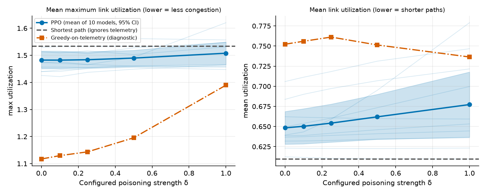
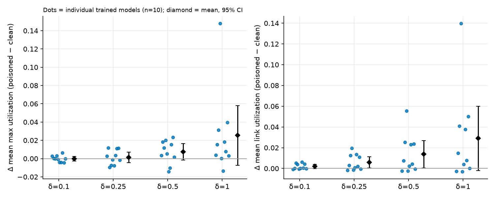
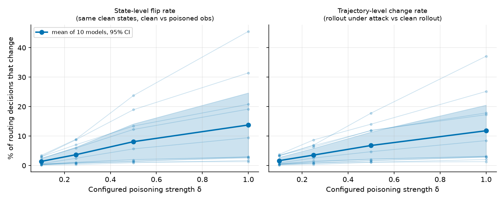
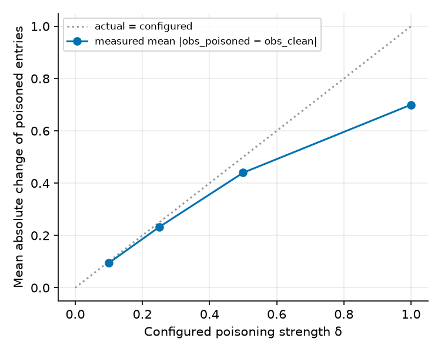

# Phase 1 Report — PPO Routing Under Observation Poisoning

*Status of this document: all numbers marked **[NEW]** were produced by the code in this package and can be regenerated; all numbers marked **[ORIGINAL]** come from the CSV files supplied with the prototype and are preserved unmodified in `originals/`. Nothing here is taken from memory or from the prior verbal description unless it was re-verified (see `reports/AUDIT_REPORT.md`).*

---

## 1. Executive summary

* **What the prototype is.** A self-contained synthetic benchmark (8 nodes, 13 links, 20 sequential demands per episode) with a Stable-Baselines3 PPO agent (MLP policy) that picks one of the 5 shortest paths per demand. It is **not** a reproduction of ENERO and no ENERO material was supplied.
* **What the attack is.** At test time, the observed utilization of two fixed links (index 0 = (0,1), index 3 = (1,3)) is shifted up by δ and clipped to [0,1]. The simulator's true loads are untouched.
* **The attack does modify the observations.** Verified by 37 automated tests and by direct measurement: poisoned entries change in ~99% of steps; measured mean |Δobs| is 0.095 / 0.232 / 0.440 / 0.700 for δ = 0.10 / 0.25 / 0.50 / 1.00 (below δ because clipping at 1.0 truncates the shift). Zero strength reproduces the clean observation bit-for-bit.
* **Original numbers confirmed, but not reproducible from code.** [ORIGINAL] PPO clean 1.5082/0.6550, shortest path 1.5040/0.6237, PPO poisoned 1.5082/0.6557 (max/mean utilization) are exactly what the supplied CSVs contain. The shortest-path row re-executes exactly; the PPO rows do **not** (retraining with identical code and seed gave 1.4946/0.6260) and the original `ppo_routing.zip` was not supplied.
* **Main new finding [NEW].** Across **10 independently trained PPO models × 100 paired scenarios**, poisoning has a **small average effect that grows with δ and varies enormously between models**. At δ = 0.5, PPO's mean decision-flip rate is 8.1% (per-model range 1.0%–23.8%); mean link utilization rises by 0.014 (95% CI across models [0.0005, 0.027]); mean max utilization rises by 0.007 (CI [−0.002, 0.017], includes 0). The effect is not uniformly directional across models. **No claim of statistical significance is made** (n = 10 models, 6 metrics × 4 strengths, no multiplicity correction).
* **Why the original effect looked negligible.** Evidence supports a combination of (i) a policy that mostly follows the shortest path (82.6% of decisions choose action 0) and uses telemetry weakly (zeroing *all* utilization inputs changes only 18% of decisions), (ii) an attack that touches only 2 of 13 links (the chosen path crosses a poisoned link in 23% of decisions), and (iii) aggregate metrics that are insensitive to a few re-routed demands. It is **not** explained by an inert attack or by saturation of the poison. It does **not** show that PPO is robust: a diagnostic policy that reads the same telemetry (greedy-on-telemetry) degrades markedly under the same attack (max utilization 1.117 → 1.390 at δ = 1).
* **PPO is not clearly better than shortest-path here [NEW].** Clean PPO has slightly lower max utilization than shortest path (−0.051, CI [−0.083, −0.020]) but higher mean utilization (+0.039), longer paths (+2.3 hops/episode) and no better reward. The agent (20k timesteps) is a weak router, so "resilience of a strong agent" is not what is being measured.
* **Biggest caveats.** Toy synthetic topology; saturated regime (98% of episodes overload a link; no loss/admission model); fixed, non-adaptive attacker; one attack form; one topology; 10 models.

## 2. Research question and motivation

*How does poisoning network telemetry or observations affect the routing decisions and performance of a PPO-based routing agent, and how can this effect be measured reproducibly?*

Learning-based traffic engineering consumes telemetry (link utilization). If telemetry is falsified, the agent's inputs — but not the physical network — change. Perturbation of observations of deep-RL policies is an established attack class (Huang et al. 2017, arXiv:1702.02284; Zhang et al. 2020, arXiv:2003.08938). Phase 1 establishes a measurable, reproducible baseline before any defence is considered.

## 3. System architecture

```
originals/            untouched supplied files + SHA256SUMS.txt
src/routing_env.py    RoutingEnv (behaviour-identical to original; + instrumentation)
src/policies.py       shortest_path_action, greedy_telemetry_action (diagnostic)
scripts/train.py      PPO training (original hyperparameters, 1 CPU thread)
scripts/run_experiment.py   paired evaluation  -> results/episodes.csv, config.json
scripts/analyze.py    tables + figures
scripts/diagnose_policy.py  telemetry-reliance / exposure diagnostics
tests/                37 tests
results/  figures/  audit/original_script_rerun/  reports/
```

## 4. Verified model description

Stable-Baselines3 PPO (Schulman et al. 2017, arXiv:1707.06347; Raffin et al. 2021, JMLR 22, jmlr.org/papers/v22/20-1364.html), `MlpPolicy`: separate policy and value networks, each 30→64→64 with tanh, 5-way categorical action head. `n_steps=256`, `batch_size=64`, `learning_rate=3e-4`, 20,000 timesteps, other settings SB3 defaults (γ=0.99, λ=0.95, clip 0.2, 10 epochs). Trained **only on clean observations**. Evaluation uses `deterministic=True` (arg-max action). Decisions: at each step the agent picks which of the 5 shortest hop-count paths to place the demand on.

Deviation from the original script (documented, purposeful): `device="cpu"` and `torch.set_num_threads(1)` so training is bit-for-bit repeatable (test `test_training_is_bitwise_repeatable_on_cpu_single_thread` passed; two same-seed runs gave identical parameter hashes).

## 5. Environment

Synthetic (no real-world data). 8 nodes, 13 undirected links (`(0,1),(0,2),(1,2),(1,3),(2,3),(2,4),(3,4),(3,5),(4,5),(4,6),(5,6),(5,7),(6,7)`), capacity 100 on every link, unit weights, 20 demands/episode with volume ~ U(10,35), uniformly random distinct source/destination. Loads only accumulate. Observation (30-dim) = 13 clipped utilizations + one-hot source + one-hot destination + volume/100. Reward = −mean_e(util²) at each step (true loads). The scenario seed fully determines the demand sequence, so every method sees identical scenarios. Not modelled: queues, packet loss, delay, link failures, flow departure, weights/latency, capacity-aware admission.

## 6. Threat model and poisoning mechanism

* **Attacker capabilities:** can add δ ≥ 0 to the *reported* utilization of links {0,1} and {1,3} on every observation delivered to the agent (clipped to [0,1]). Knows nothing else; non-adaptive (a fixed rule, does not query the policy).
* **Attacker cannot:** change true loads, rewards, demands, model parameters or training data; cannot hide congestion (offset is non-negative); cannot affect other links or the demand features.
* **Timing:** test-time only. The agent was trained on clean data. This is observation poisoning, **not** training-data poisoning or parameter poisoning.
* **Strength definition:** δ ∈ {0, 0.10, 0.25, 0.50, 1.00}. 0 – 0.5 correspond to the original sweep (0.10/0.25/0.50); **1.00 is a Phase 1 extension** (equivalent to presenting both links as fully loaded). Because of clipping, the *effective* perturbation is `min(δ, 1 − util)`, measured and reported rather than assumed.

## 7. Experimental design

* **Models:** 10 PPO agents, training seeds 42–51 (seed 42 = original seed). Models are the statistical unit.
* **Scenarios:** 100 evaluation scenarios, seeds 100–199 (seeds 100–119 = the original 20, reported separately for continuity). Identical scenario → identical demands for every method/δ/model ⇒ **fully paired**.
* **Conditions:** shortest path (clean + verified-identical under each δ); PPO at δ ∈ {0,.10,.25,.50,1.00}; greedy-on-telemetry diagnostic at each δ.
* **Statistics:** per-model mean of paired differences over the 100 scenarios; then mean, SD and t-interval across the 10 models; counts of models with increase/decrease. Episodes of one model are not treated as independent replicates of the model.
* **Determinism:** training is deterministic given a seed (CPU, 1 thread). Evaluation uses arg-max actions and deterministic scenario seeds, so the whole pipeline is deterministic on a given software stack; variability across seeds is *between models and scenarios*, not within a run.
* **Compute performed:** 10 trainings (~29 s each), 6,000 evaluation episodes (130 s). No failed or missing runs.

## 8. Baselines and metrics

| Metric (all on TRUE loads, end of episode unless noted) | Definition | Better |
|---|---|---|
| max utilization | max_e L_e/C | lower (values > 1 = demand exceeds capacity) |
| mean utilization | mean_e L_e/C = Σ vol·hops/(13·C) | lower (it is a **path-length proxy**, not load balance) |
| squared utilization | mean_e (L_e/C)² | lower |
| episode reward | Σ_t −mean_e(L_e(t)/C)² | higher; a congestion-shaped training signal, **not** a security measure |
| overloaded links | #{e : L_e/C > 1} | lower (congestion events) |
| total hops | Σ_t (|path_t|−1) | lower (unit-weight routing cost) |
| invalid actions | out-of-range actions | 0 by construction (env raises; policy head is Discrete(5)) |
| state-level flip rate | on the **clean** trajectory's own states, share of decisions whose arg-max action differs between poisoned and clean observation | – (attack effectiveness) |
| trajectory-level change rate | share of steps whose action differs from the same model's clean rollout (compounds after first divergence) | – |
| packet loss / delivery | **not modelled** | – |

Baselines: **shortest path** = static minimum-hop path (action 0; ignores telemetry, therefore unaffectable by poisoning — a *measured* check in `episodes.csv` shows identical results for every δ); **greedy-on-telemetry** (diagnostic only; reads the same observation, picks min(max observed util, sum observed util, hops); inherits the 1.0 clipping, so it is not an oracle).

## 9. Implementation and validation checks

All executed; log in `results/logs/pytest_full.log` — **37 passed** (`RUN_SLOW=1 python -m pytest`; 36 passed + 1 skipped without `RUN_SLOW`).

* Zero-strength poisoning ≡ clean (bitwise). ✔
* Only the targeted observation entries change; others untouched. ✔
* Actual change = `min(δ, 1 − clean)` per poisoned entry; never negative. ✔
* A saturated link makes the poison a no-op (expected clipping behaviour). ✔
* Observations stay in [0,1], float32, finite, for δ ∈ {−0.3 … 5.0}. ✔
* Poisoning does not change true loads, rewards or terminal metrics for identical actions. ✔
* Fixed seed reproduces demands/observations; different seeds differ. ✔
* `counterfactual_observation(δ)` equals the observation of a δ-poisoned environment in the same state. ✔
* The flip-measurement pipeline detects a telemetry-sensitive stub policy, reports 0 for a constant one, and is monotone in δ. ✔
* New environment is **identical to the original** (observations, rewards, original info keys) for clean and δ ∈ {0.1, 0.25, 0.5} on 10 seeds; shortest-path results reproduce the original `results.csv` rows within 1e-6; the original CSV facts quoted in this report are asserted. ✔
* Metric definitions are consistent with the true state; invalid actions raise. ✔
* Whether the *agent's* action changes under poisoned vs clean observation is measured on real trained models in §10 (not just stubs).

## 10. Results

### 10.1 Original results [ORIGINAL] — confirmed

| | n | mean max util | mean link util |
|---|---|---|---|
| PPO clean | 20 episodes, 1 model | 1.5082 | 0.6550 |
| PPO poisoned δ=0.25 | 20 | 1.5082 | 0.6557 |
| Shortest path | 20 | 1.5040 | 0.6237 |

In the original strength sweep, decisions changed: δ=0.10: 0/400; δ=0.25: 1/400; δ=0.50: 1/400 (same decision), one affected episode of 20. Interpretation: for that one model, the attack was barely visible; given §10.3 this is not evidence of general robustness, only of one model's behaviour. Shortest-path "poisoned" values carry no information (B3 in the audit).

### 10.2 New results [NEW]: performance (mean over 10 models; 95% t-interval across models; 100 paired scenarios)

| δ | max util | mean util | overloaded links | total hops | episode reward |
|---|---|---|---|---|---|
| 0 (clean) | 1.4825 [1.451, 1.514] | 0.6483 [0.628, 0.669] | 2.74 | 37.87 | −4.995 |
| 0.10 | 1.4823 [1.451, 1.514] | 0.6503 [0.629, 0.672] | 2.75 | 37.99 | −5.019 |
| 0.25 | 1.4838 [1.455, 1.513] | 0.6542 [0.631, 0.678] | 2.76 | 38.22 | −5.058 |
| 0.50 | 1.4899 [1.461, 1.519] | 0.6620 [0.634, 0.690] | 2.83 | 38.67 | −5.170 |
| 1.00 | 1.5078 [1.466, 1.550] | 0.6773 [0.637, 0.718] | 2.93 | 39.59 | −5.414 |
| Shortest path (any δ) | 1.5335 | 0.6096 | 2.62 | 35.60 | −4.822 |
| Greedy-on-telemetry, δ=0 → 1.0 | 1.117 → 1.390 | 0.752 → 0.736 | 2.20 → 3.70 | 43.97 → 43.02 | −4.850 → −5.737 |

Continuity subset (original 20 scenarios 100–119, pooled over the 10 new models): PPO clean 1.4650/0.6622; shortest path 1.5040/0.6237 (**identical to the original**, confirming scenario equivalence).


*Fig 1. Performance versus configured poisoning strength. Thick blue: mean over 10 PPO models with 95% t-interval across models; thin lines: individual models. Dashed grey: shortest path (unaffected). Orange: greedy-on-telemetry diagnostic. Left: mean maximum link utilization (lower = less congestion). Right: mean link utilization (lower = shorter paths).*

### 10.3 New results [NEW]: paired effect of poisoning on PPO (poisoned − clean, same model & scenario)

| δ | Δ max util [95% CI] | Δ mean util [95% CI] | models with Δ mean util > 0 / < 0 | Δ overloaded links [CI] | episodes with any action change |
|---|---|---|---|---|---|
| 0.10 | −0.0001 [−0.0026, 0.0023] | +0.0019 [−0.0000, 0.0039] | 7 / 3 | +0.013 [−0.021, 0.047] | 21% |
| 0.25 | +0.0013 [−0.0045, 0.0072] | +0.0059 [0.0005, 0.0113] | 7 / 3 | +0.020 [−0.023, 0.063] | 41% |
| 0.50 | +0.0074 [−0.0016, 0.0165] | +0.0137 [0.0005, 0.0269] | 7 / 3 | +0.092 [0.003, 0.181] | 58% |
| 1.00 | +0.0253 [−0.0074, 0.0580] | +0.0290 [−0.0022, 0.0601] | 8 / 2 | +0.190 [−0.078, 0.458] | 67% |

(Full table incl. reward, squared utilization, hops: `results/summary_tables.md`, `results/paired_effects_poisoned_minus_clean_ppo.csv`.)

Reading: the mean effect is small and rises with δ; max-utilization intervals include zero at every δ; some intervals for mean utilization, hops and overloaded links exclude zero but are unadjusted for multiplicity and for the n=10 model sample, and the **sign of the episode-reward change is not consistent across models** (4 vs 6). The data are compatible with a small real degradation but do not establish it.


*Fig 4. Per-model paired change (poisoned − clean) in mean max utilization (left) and mean link utilization (right). Dots = individual trained models; diamond = mean with 95% interval. One model (seed 45) reaches +0.14 at δ=1; some models change by about 0 or slightly negative values.*

### 10.4 New results [NEW]: decisions and measured perturbation

| δ | measured mean \|Δobs\| on poisoned links | steps where poison is active | state-level flip rate, mean [min, max over models] | trajectory-level change rate (mean) |
|---|---|---|---|---|
| 0.10 | 0.095 | 98.9% | 1.4% [0.15%, 3.5%] | 1.7% |
| 0.25 | 0.232 | 99.0% | 3.7% [0.3%, 8.9%] | 3.6% |
| 0.50 | 0.440 | 99.0% | 8.1% [0.95%, 23.8%] | 6.8% |
| 1.00 | 0.700 | 99.0% | 13.8% [1.3%, 45.6%] | 11.8% |


*Fig 2. Share of routing decisions that change with poisoning. Left: state-level (same clean states, clean vs poisoned observation). Right: trajectory-level (full rollout under attack vs clean rollout). Thick: mean of 10 models with 95% interval; thin: individual models.*


*Fig 3. Measured versus configured perturbation of the poisoned observation entries (mean over steps, links and models). The gap to the diagonal at large δ is caused by clipping at 1.0.*

### 10.5 New results [NEW]: PPO versus shortest path (clean, paired by scenario; PPO − SP, across 10 models)

| Metric | PPO − SP [95% CI] | models where PPO is higher |
|---|---|---|
| max util | −0.0510 [−0.0826, −0.0195] | 1 / 10 |
| mean util | +0.0387 [0.0183, 0.0590] | 10 / 10 |
| total hops | +2.27 [1.11, 3.43] | 10 / 10 |
| episode reward | −0.174 [−0.380, +0.033] | 2 / 10 |
| overloaded links | +0.12 [−0.022, 0.262] | 6 / 10 |

PPO trades longer paths for a slightly lower worst-link utilization, with no reward advantage. The greedy diagnostic reaches max utilization 1.12 at the cost of ~6 more hops, showing that the environment offers telemetry-dependent headroom that this 20k-step PPO does not capture.

### 10.6 Diagnosis of "why is the effect small" (`results/policy_diagnostics.csv`, mean over 10 models, 2,000 decisions each)

| Quantity | Value | Meaning |
|---|---|---|
| decisions choosing action 0 (shortest path) | 82.6% (range 56.8%–98.7%) | policy is close to static routing |
| decisions that change if ALL utilization inputs are zeroed | 18.0% (8%–28%) | telemetry is used weakly |
| … if only the 2 poisoned links are zeroed | 3.6% (0.4%–11%) | the policy depends little on those 2 inputs |
| chosen path crosses a poisoned link | 23.3% | limited exposure |
| any of 5 candidates crosses one | 65% | |
| poisoned entries already saturated at 1.0 | 1.2% | clipping is **not** why the effect is small |

Competing explanations, assessed: *Inert attack / implementation fault* — rejected (tests + 99% active + measured perturbations + a telemetry-reading policy degrades sharply). *Saturation* — rejected (1.2% of states). *Insensitive metrics* — partly supported (mean utilization is a hop-count proxy; max utilization is an extreme-value statistic over 13 links in a saturated regime). *Genuine stability* — **not supported as "robustness"**: the small effect coincides with weak telemetry use by an under-trained policy, and it varies from ≈0 to a +0.14 change across models. These are inferences from correlations in the diagnostic table, not causal proofs.

## 11. Limitations and unresolved issues

1. Toy synthetic topology and workload; saturated regime; no loss, delay, failures, flow departures. The brief's "packet loss / delivery" metric cannot be computed.
2. Original `ppo_routing.zip` missing; original PPO numbers cannot be reproduced; the cause is undetermined. All **new** PPO results use freshly trained models (so [ORIGINAL] and [NEW] PPO values are not directly comparable, except the shortest-path rows, which are identical).
3. One attack family (additive, fixed two links, non-adaptive, test-time only). No optimization-based or adaptive attacker; no budget-constrained link selection.
4. n = 10 models; intervals use a t-distribution on 10 values; no multiplicity correction; no hypothesis tests were run, so no significance claim.
5. 20k-timestep agents are weak; results may differ for well-trained agents, other hyperparameters or architectures.
6. Evaluation scenarios were not explicitly checked against the training RNG stream for overlap.
7. Single software stack (CPU, Python 3.13, torch 2.14.1, SB3 2.9.0); a clean-virtualenv installation from `requirements.txt` was **not** tested (see PHASE1_STATUS).
8. Greedy-on-telemetry is a diagnostic, not an optimum; ENERO was not obtained or compared.

## 12. Conclusions supported by the evidence

1. The poisoning mechanism does change the observations the agent receives, by the measured amounts above, and nothing else (tests, §9).
2. For the 10 trained agents, poisoning increases the share of changed routing decisions in a dose-dependent way (mean 1.4% → 13.8% from δ = 0.1 to 1.0).
3. The mean impact on network metrics is small and, for the utilization metrics, mostly compatible with zero at the 95% level; heterogeneity between independently trained models exceeds the average effect. A single-model, 20-scenario experiment (as in the original data) cannot characterize this.
4. The original "no difference" result is real for that model/scenario set but should not be read as evidence that PPO routing is robust to telemetry poisoning.
5. This PPO agent does not clearly outperform static shortest-path routing in this environment, which limits what can be concluded about attacking "a good router".

**Not established:** effectiveness of stronger/adaptive attacks; behaviour in realistic networks; statistical significance; any defence; any relation to ENERO.

## 13. Proposed Phase 2 (prioritized)

1. **Make the benchmark meaningful (blocking):** feasible load (avoid the 98% overload regime), a loss/delivery or admission model, and a capacity-aware or weighted shortest-path baseline; then demonstrate PPO ≥ baseline before attacking it.
2. **Stronger attacks:** budgeted, optimization- or gradient-based observation attacks (cf. Huang et al. 2017; Zhang et al. 2020), selection of which links to poison, and a per-step L∞ budget; report worst-case rather than a single fixed rule.
3. **More and better-trained agents:** longer training, ≥ 30 training seeds, then paired tests with multiplicity control.
4. **Unseen scenarios/topologies:** at least one verified public topology (candidates to be verified for access and licence before use — not claimed here) and held-out demand distributions.
5. **Only then defences** (observation validation, bounded telemetry correction, robust training), evaluated against the same attacks.
6. **ENERO comparison** only after the original ENERO code, topologies and training protocol are obtained and verified.
7. **Literature review** of RL-for-routing security before any novelty claim; none is made here.

---
### References (checked to exist via web search on 2026-10-24; only abstracts/metadata consulted)
* Schulman et al., *Proximal Policy Optimization Algorithms*, arXiv:1707.06347 (2017).
* Raffin et al., *Stable-Baselines3: Reliable Reinforcement Learning Implementations*, JMLR 22 (2021), https://jmlr.org/papers/v22/20-1364.html.
* Huang, Papernot, Goodfellow, Duan, Abbeel, *Adversarial Attacks on Neural Network Policies*, arXiv:1702.02284 (2017).
* Zhang et al., *Robust Deep Reinforcement Learning against Adversarial Perturbations on State Observations*, NeurIPS 2020, arXiv:2003.08938.
* Almasan, Xiao, Cheng, Shi, Barlet-Ros, Cabellos-Aparicio, *ENERO: Efficient Real-Time WAN Routing Optimization with Deep Reinforcement Learning*, arXiv:2109.10883 (DOI 10.1016/j.comnet.2022.109166; venue not independently verified).
